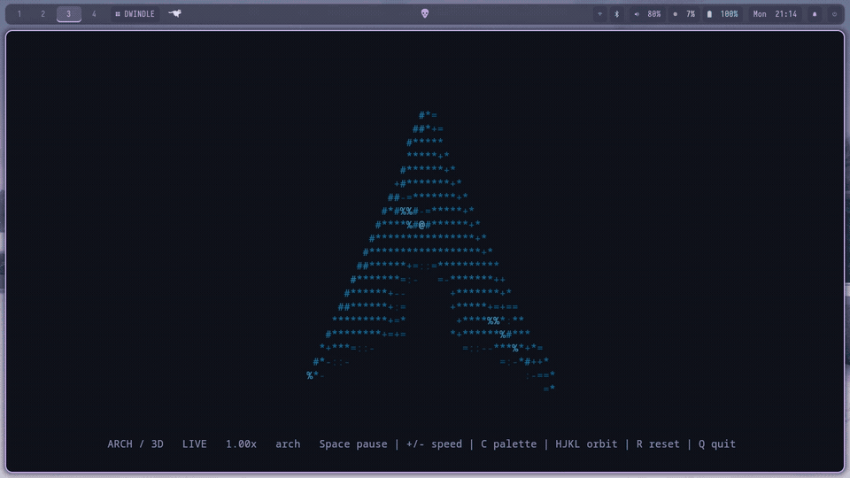

# arch.c

A spinning 3D ASCII Arch Linux logo, written in a single C file.

**Heavily inspired by [areofyl/gentoo.c](https://github.com/areofyl/gentoo.c).**
This project adapts its spinning distro-logo idea and rendering approach for Arch:
an extruded point cloud, perspective projection, surface lighting, and a depth
buffer. Credit to areofyl for the original Gentoo implementation and inspiration.



Recorded live on Hyprland workspace 3. [Still screenshot](screenshot.png).

## Build and run

```sh
cc -std=c11 -O2 arch.c -o arch -lm
./arch
```

Needs a C compiler and a POSIX/Linux terminal. Only libc and libm are linked.
No Python, image libraries, generated headers, or external artwork files are
needed to build or run it. The GIF and screenshot are documentation only.

## Features

- ASCII characters only, with a darker Arch-blue palette and softer highlights.
- Arch's actual emblem silhouette, generated directly in C with beveled depth.
- Depth-tested perspective and diffuse/specular lighting.
- Smooth, time-based rotation that lingers near the recognizable front view.
- Terminal resizing, pause/orbit controls, and configurable speed/frame rate.
- Terminal contents, cursor, and input settings restored on exit or suspension.

## Controls

| Key | Action |
| --- | --- |
| Space | Pause / resume |
| `+` / `-` | Faster / slower |
| C | Cycle Arch, ice, rose, and monochrome palettes |
| H / L | Turn left / right |
| J / K | Tilt down / up |
| R | Reset rotation and speed |
| Q / Esc | Quit |
| Ctrl+C | Exit cleanly |
| Ctrl+Z | Suspend; use `fg` to resume |

## Options

```sh
./arch --speed 0.5                # slower rotation
./arch --fps 30                   # lower frame rate
./arch --palette rose             # arch, ice, rose, mono
./arch --no-hud                   # just the logo
./arch --no-color                 # uncolored ASCII
./arch --frames 180               # stop after 180 frames
./arch --snapshot                 # one plain 80x24 frame
./arch --help
```

Piping output automatically produces a single plain snapshot. Colors use 24-bit
ANSI sequences; `NO_COLOR` disables them. If your environment sets `NO_COLOR` and
you want the blue palette, run `env -u NO_COLOR ./arch`. A transparent terminal
keeps its existing background.

## Credits

- **Primary inspiration:** [areofyl/gentoo.c](https://github.com/areofyl/gentoo.c),
  the original animated ASCII Gentoo-logo renderer. This Arch adaptation keeps the
  same core idea while changing the shape, shading, animation loop, and terminal
  handling. It is an independent adaptation, not the upstream project.
- **Arch emblem:** the path comes from the official
  [Arch Linux artwork](https://archlinux.org/art/). Arch Linux and its logo are
  trademarks; see the [Arch trademark policy](https://terms.archlinux.org/docs/trademark-policy/).
